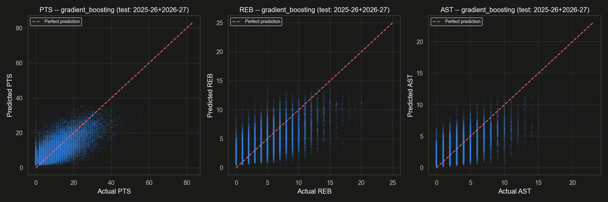
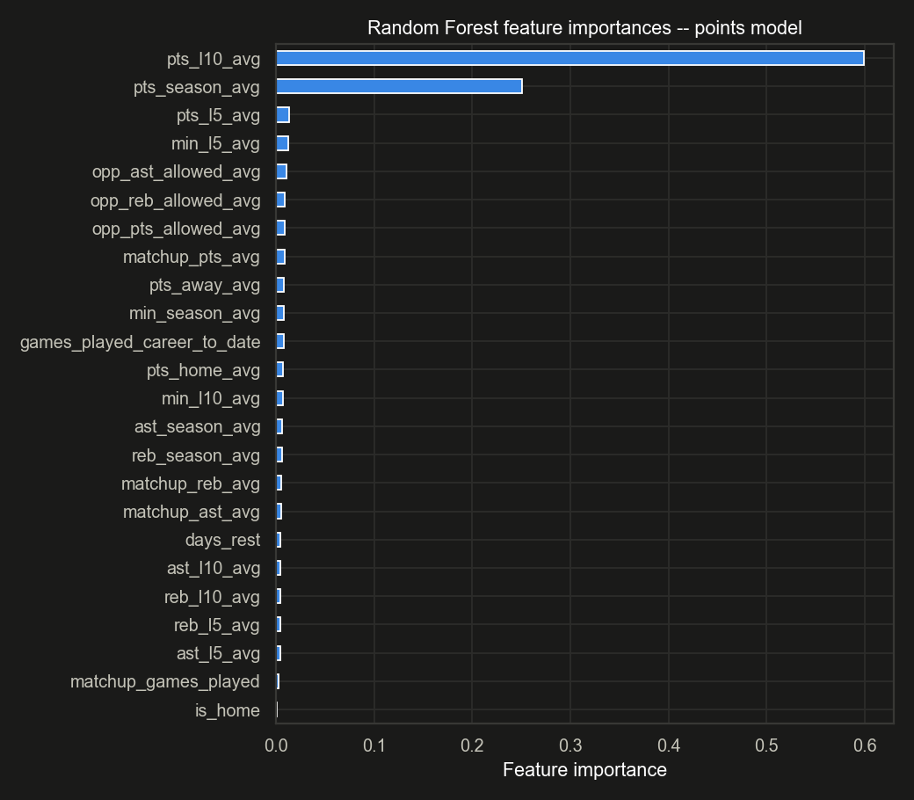

# CourtIQ

A full-stack NBA analytics and predictive modeling platform: player search,
multi-player comparison, opponent matchup analysis, trend exploration, and
ML-based predictions for points/rebounds/assists.

**Status:** All four phases complete and tested — database + data pipeline,
backend API, frontend, and ML models (built in that order except frontend
and ML, done out of order at the user's request: frontend landed before the
models existed, with the Predictions page initially showing a real, honest
"not trained yet" state; `/api/predict` now serves real trained-model
predictions).

## Architecture

```
courtiq/
├── frontend/   React + TypeScript + Tailwind + Recharts
├── backend/    FastAPI + SQLAlchemy + Pydantic + Alembic
├── data/       local cache of downloaded source files (not committed)
├── ml/         pandas/scikit-learn training & evaluation pipeline
├── scripts/    CLI entry points: ingest_data.py, build_features.py, train_models.py
└── docs/
```

**How the pieces talk to each other:**

- The **frontend never touches Postgres directly.** It only calls the FastAPI
  REST API (`/api/players`, `/api/players/{id}/gamelog`, `/api/predict/...`)
  and renders JSON responses with Recharts.
- **FastAPI owns all database access** (via SQLAlchemy) and, for predictions,
  loads pre-trained model files (`.joblib`) produced offline by `ml/` — so a
  request never triggers live model training, only inference.
- **`ml/` trains offline** against the same Postgres tables the API reads,
  using the SQLAlchemy models defined once in `backend/app/db/models.py` and
  imported by both the backend and the training/ingestion scripts, so there
  is a single schema definition, not two copies that can drift apart.
- **`scripts/`** are the operational entry points that actually move data:
  `ingest_data.py` (raw data → Postgres) and `build_features.py` (Postgres →
  leakage-safe feature table), both run from the project root.

## Dataset

**Source:** [`cbratkovics/nba-game-logs`](https://huggingface.co/datasets/cbratkovics/nba-game-logs)
on the Hugging Face Hub — a public, un-gated backfill of the Kaggle
["NBA Dataset: Box Scores and Stats"](https://www.kaggle.com/datasets/eoinamoore/historical-nba-data-and-player-box-scores)
by Eoin Moore, resolved to one row per player per regular-season game.

**Why this one:** it needed no account/API key (several alternatives required
Kaggle credentials), ships as clean per-season Parquet files, and — verified
directly, not assumed — contains exactly the fields the spec calls for
(points, rebounds, assists, minutes, makes/attempts for FG/3P/FT, steals,
blocks, turnovers, plus/minus, opponent, home/away, date, season) with **zero
nulls, zero duplicate (game, player) pairs, and zero stat inconsistencies**
(no `fgm > fga` etc.) across all six seasons loaded.

**Coverage loaded:** seasons `2021-22` through `2026-27` (current, in
progress) — **134,960 player-game rows**, 6,345 games, 1,084 players, well
over the 100K-record target and across multiple full seasons.

The dataset repo also contains an unrelated betting/model-ops pipeline
(`gold/`, `replay/`, `drift/`, `ledger/` folders) belonging to its author's
own project — only the `game_logs/*.parquet` files are used here.

To extend history further back, the original Kaggle dataset covers 1946–present;
that path needs a Kaggle API key (`~/.kaggle/kaggle.json`) and isn't wired up
yet, since the HF mirror already clears the data requirements on its own.

## Database schema

Postgres, via SQLAlchemy models in `backend/app/db/models.py`:

| Table | Grain | Notes |
|---|---|---|
| `teams` | 1 row / franchise | Static reference data (name, conference, division); abbreviation is the PK. |
| `players` | 1 row / player | `full_name`, first/last season seen, career games played. |
| `games` | 1 row / game | Home/away team FKs, date, season. |
| `player_game_stats` | 1 row / player / game | The raw box score. `game_date`/`season` are **denormalized** from `games` directly onto this table — nearly every analytics query here filters/orders by date per player, and avoiding a join on a 135K-row hot path was a deliberate call. Shooting percentages (`fg_pct`, `fg3_pct`, `ft_pct`) are computed from makes/attempts at ingest time, **never averaged across games** — averaging per-game percentages is statistically wrong; the correct aggregate is sum(makes)/sum(attempts). |
| `player_game_features` | 1 row / player / game, 1:1 with `player_game_stats` | Precomputed ML/trend features — see below. Shared by the "trends" API endpoints and the ML training pipeline so both use identical feature definitions. |

### Feature engineering (`player_game_features`)

Every value is computed from games **strictly before** that row's own
`game_date` — enforced with `.shift(1)` ahead of any rolling/expanding window,
verified directly (see Verification below), not just asserted:

- Last-5 / last-10 game rolling averages (pts, reb, ast, minutes)
- Season-to-date averages (reset each season)
- Home vs. away season-to-date splits
- **Opponent defensive proxy:** average pts/reb/ast the opponent has allowed
  to all players, prior games only
- **Historical matchup:** the player's own career average vs. this specific
  opponent, prior meetings only (spans seasons)
- Career games played to date, days of rest since the previous game

## Backend API

FastAPI, modular by layer: `app/api/` (routers, HTTP concerns only) →
`app/services/` (SQL/business logic, framework-agnostic) → `app/db/models.py`
(schema). `app/schemas/` holds the Pydantic request/response models.

| Endpoint | Purpose |
|---|---|
| `GET /api/teams` | All 30 teams, with real brand colors |
| `GET /api/players?limit=&offset=` | All players, paginated |
| `GET /api/players/search?q=` | Search by name |
| `GET /api/players/{id}` | Player detail + career averages |
| `GET /api/players/{id}/headshot` | Proxies the player's real NBA.com headshot (see "User feedback pass" below for why it's proxied, not a direct CDN link) |
| `GET /api/players/{id}/gamelog?season=&opponent=&limit=&offset=` | Game-by-game box scores |
| `GET /api/players/{id}/season-averages` | Per-season + career aggregates (shooting % = ΣmakesΣattempts, not averaged) |
| `GET /api/players/{id}/trends?season=&last_n=` | Time series with L5/L10 rolling averages, for charting |
| `GET /api/players/{id}/matchup/{opponent}?season=` | History vs. one specific opponent, home/away split |
| `GET /api/players/{id}/upcoming?limit=` | The player's next real, unplayed games (live ESPN lookup — our own DB has no future games by design; see below) |
| `GET /api/leaders?stat=pts\|reb\|ast\|stl\|blk&season=&limit=` | True season leaders, **no games-played floor** (changed on request — see below) |
| `GET /api/compare?player_ids=1,2,3&season=` | Side-by-side averages for 2–6 players |
| `POST /api/predict` | Predicted pts/reb/ast for a player vs. an opponent, using whichever trained model had the lowest measured test-set MAE per stat. Returns 503 if `scripts/train_models.py` hasn't been run (e.g. a fresh clone). |

Run it:
```bash
cd backend
PYTHONPATH=. uvicorn app.main:app --reload --port 8000
# interactive docs: http://localhost:8000/docs
```

Tests (31, integration-style against the real dev DB — this is a data app,
so the SQL itself is what needs covering):
```bash
python -m pytest   # from project root; pytest.ini points at backend/tests
```

**A bug the tests caught:** the same "`None` into a float64/int64 pandas
column silently reverts to `NaN`" issue fixed in `build_features.py` during
Phase 1 also existed, unfixed, in `ingest_data.py`'s shooting-percentage
calculation — `fg_pct`/`fg3_pct`/`ft_pct` were stored as literal Postgres
`NaN` (not `NULL`) whenever a player had 0 attempts (e.g. no 3-point
attempts that game: 27,808 of 134,960 rows). This didn't error on insert
(Postgres floats accept `NaN`), so Phase 1's verification missed it — it
surfaced when the `/trends` endpoint tried to JSON-serialize a response
containing one, since strict JSON has no `NaN` token. Fixed the same way
(cast to object dtype before replacing), re-ran ingestion + features, and
added a regression test (`test_trends_no_leakage_on_first_game_of_dataset`)
plus direct DB checks so this class of bug can't hide behind `IS NOT NULL`
again.

## Frontend

React 19 + TypeScript + Tailwind v4 + Recharts, built with Vite. Light theme,
blue-monochrome (flipped from an initial dark/colorblind-safe-categorical
theme after direct feedback — see "User feedback pass" below): white/near-
white background, blue for every line/chart/accent, near-black text. Team
badges and logos are the one deliberate exception, keeping each team's real
brand color. Where a chart must still tell 2+ series apart (trend lines,
comparison bars, home/away bars), series colors are different *lightness
steps* of the same blue rather than different hues.

Every page with meaningful input state (search, selected players, chosen
opponent, season, stat tab) persists it to `sessionStorage` via
`usePersistentState` — navigating to another tab and back restores exactly
where you left off, including mid-filled forms, within the same browser tab.

| Page | Route | What it does |
|---|---|---|
| Dashboard | `/` | All 5 league-leader categories (pts/reb/ast/stl/blk, no games floor) stacked in one scrollable column, big player search |
| Players | `/players` | Browse (paginated) or search the full player database, with headshots + team badges |
| Player Profile | `/players/:id` | Team-colored header with headshot, career + season-by-season stats, L5/L10 trend chart with stat tabs |
| Compare | `/compare` | 2–6 players side-by-side; the chart/table are always visible and fill in as each player is added (no "add 2 players" gate) |
| Matchup | `/matchup` | Dedicated left (player) / right (opponent, with real team logo) panels; full analysis renders below once both are picked |
| Predictions | `/predict` | Shortcuts to the player's actual next games (real schedule, one tap to predict), predicted pts/reb/ast with measured MAE, plus real L10/season/matchup context |

Structure: `src/api/client.ts` (typed fetch wrapper) → `src/hooks/useFetch.ts`
(loading/error state) → `src/pages/*` (one per route) → `src/components/*`
(shared: layout, autocomplete, team select, stat card, chart wrappers).
`src/types/api.ts` mirrors the backend Pydantic schemas by hand (no codegen
yet — keep both in sync when either changes).

Run it:
```bash
cd frontend
npm install
npm run dev   # http://localhost:5173 (needs the backend running on :8000)
```

**Verification:** no interactive browser was available in this environment
(no Chrome extension connected), so this was tested with a headless
Playwright Chromium instead — `npm run smoke` (every route, fresh page,
captures console errors) and `npm run smoke:interactive` (fills in real
selections: a player + opponent on Matchup/Predict, two players on Compare)
write PNGs to `frontend/screenshots/` (gitignored) and print any console
errors per page.

**Two real bugs this verification caught and fixed:**
1. `PlayerAutocomplete`'s `excludeIds` prop defaulted via `= []`. A JS default
   parameter allocates a *new* array every time the function runs — including
   a re-render triggered by the component's *own* internal state, independent
   of its parent. That new reference fed the search-debounce effect's
   dependency array, re-triggering the effect every render: a self-sustaining
   infinite loop, entirely self-contained, whenever a caller omitted the prop
   (Dashboard, Matchup, Predict all did). It didn't surface on Compare only
   because there the prop was actually passed through from the parent.
   Fixed with a module-level constant array instead of a fresh literal.
2. (Not a bug, but worth recording:) a bar chart briefly screenshotted as
   empty — turned out to be Recharts' default ~1.5s enter animation caught
   mid-flight by a 1-second wait in the test script, not broken rendering
   (confirmed by re-reading the DOM: valid `<path>` geometry, correct resolved
   `fill` color, just not yet animated in). Disabled enter animations on all
   charts app-wide (`isAnimationActive={false}`) since instant rendering suits
   a dense analytics dashboard and makes automated verification deterministic.

## Setup

### Prerequisites
Python 3.13, Node 22 (for the frontend, once built). No system Postgres or
Docker required for local dev — see below.

### 1. Python environment
```bash
python3 -m venv .venv
source .venv/bin/activate
pip install -r requirements.txt
```

### 2. Local Postgres
Homebrew's `postgresql@16` builds Postgres **and every dependency from
source** in this environment (no prebuilt bottle available), which can take
30–60+ minutes. Instead, a prebuilt Postgres.app binary (PG 16.16) is vendored
locally under `.tools/` — no system install, no sudo, no Docker:

```bash
scripts/pg_dev.sh start   # starts Postgres on localhost:5432
scripts/pg_dev.sh status
scripts/pg_dev.sh psql    # opens a psql shell
scripts/pg_dev.sh stop
```

(`.tools/` is gitignored — it's a local binary cache, not part of the repo.
On a machine with Docker available, use `docker-compose.yml`'s `db` service
instead and skip this step.)

The `courtiq` role/database were created once via:
```sql
CREATE ROLE courtiq WITH LOGIN PASSWORD 'courtiq_dev_password';
CREATE DATABASE courtiq OWNER courtiq;
```

### 3. Schema
```bash
cp .env.example .env   # adjust if needed
alembic upgrade head
```

### 4. Load data
```bash
PYTHONPATH=backend python scripts/ingest_data.py     # downloads + cleans + loads raw box scores
PYTHONPATH=backend python scripts/build_features.py  # computes leakage-safe rolling/matchup features
```

Both are idempotent (truncate-and-reload) — safe to re-run after a schema
change or to pick up newly played games in the current season.

## Verification (what's actually been tested, not just asserted)

- **Row counts:** 134,960 rows in both `player_game_stats` and
  `player_game_features` (1:1 as designed); 6,345 games; 1,084 players; 30 teams.
- **No leakage:** every player's very first game in the data has `NULL`
  rolling/season/matchup averages (checked by SQL query against the full table,
  zero violations) — there is no prior game to average, and the pipeline
  doesn't invent one.
- **Correctness against ground truth:** LeBron James' actual 2023-10-24
  season-opener box score (LAL @ DEN: 21 pts / 8 reb / 5 ast, 10-of-16 FG) is
  correctly stored; a manually-computed `AVG(pts)` SQL aggregate over his
  2023-24 games before 2024-01-01 (25.4194) matches the stored
  `pts_season_avg` feature value for his first game on/after 2024-01-01 to
  11 decimal places.
- **Data quality:** zero duplicate `(game_id, player_id)` pairs, zero
  `fgm > fga` (or 3P/FT equivalents), zero negative stats, zero nulls in the
  raw source — checked across all 134,960 source rows before load.

## Machine learning

`scripts/train_models.py` trains **4 model types × 3 targets** (pts/reb/ast)
= 12 models, using the leakage-safe features in `player_game_features`
(including two schedule-fatigue features, `is_back_to_back` and
`home_stand_streak`, added in a later pass — see below). For each target,
the model with the lowest test-set MAE is saved to
`ml/models/{target}_model.joblib` and served by `/api/predict`.

**Time-based split (never random):** train on seasons 2021-22..2024-25
(103,766 rows), test on 2025-26..2026-27 (31,194 rows) — every test-set game
is chronologically after every training-set game, verified by an assertion
in the script itself and a dedicated test (`test_train_test_seasons_do_not_overlap`).
Random Forest and Gradient Boosting are **hyperparameter-tuned**
(`RandomizedSearchCV`, 8 candidates × 3 folds) using `TimeSeriesSplit` — a
time-respecting cross-validation on the training set only, so even *model
selection* never peeks at a chronologically later game; the real held-out
test set is touched exactly once, for final reporting.

**Real, measured results** (not fabricated — see `ml/models/metrics.json`
after running the script, and the regenerable plots in `docs/ml_plots/`).
Gradient Boosting is [XGBoost](https://xgboost.readthedocs.io/) when its
native library loads (macOS needs `brew install libomp` first — one-time,
~30s), else sklearn's `HistGradientBoostingRegressor` automatically, logged
either way in `metrics.json`'s `boosting_implementation` field:

| Target | linear (L10 only) | multiple linear | random forest (tuned) | gradient boosting (tuned) | **best** |
|---|---|---|---|---|---|
| PTS | MAE 4.728, R² 0.496 | MAE 4.619, R² 0.515 | MAE 4.606, R² 0.520 | MAE 4.588, R² 0.522 | **gradient_boosting** |
| REB | MAE 1.949, R² 0.408 | MAE 1.903, R² 0.432 | MAE 1.900, R² 0.435 | MAE 1.897, R² 0.435 | **gradient_boosting** |
| AST | MAE 1.380, R² 0.467 | MAE 1.347, R² 0.489 | MAE 1.350, R² 0.490 | MAE 1.344, R² 0.492 | **gradient_boosting** |

Every richer model beats the single-feature baseline, and tuned Gradient
Boosting (XGBoost) now wins on all three targets. Reported honestly: the
gains are **real but modest** (points MAE 4.615 → 4.588 from the original
Phase 3 Random Forest) — most of it came from the better algorithm and
tuning, not the two new schedule-fatigue features, whose individual feature
importance is near zero (see `docs/ml_plots/pts_feature_importance.png` —
`is_back_to_back` and `home_stand_streak` sit at the very bottom). That's an
honest, expected result discussed with the user before building this pass:
rolling scoring averages dominate because they already implicitly capture
most of what matters; the features most likely to meaningfully move this
further (injury/lineup status, Vegas lines) require a paid sports-data API,
which was explicitly deferred — see "Possible extensions" below. An R² in
the 0.4–0.5 range is in line with what's realistic for single-game NBA
box-score prediction from rolling averages alone: game-to-game variance is
inherently high (blowouts, foul trouble, injuries mid-game), and this is
being evaluated on its hardest case, not cherry-picked.




**Live inference** (`backend/app/services/predict_service.py`) recomputes
the same feature set anchored to "right now" instead of a past game — i.e.
including the player's most recent game in their L5/L10/season averages,
for a next game that hasn't been played yet. Missing history (e.g. a
rookie's first few games) is median-imputed by the same `SimpleImputer`
fit during training, so a low-history player gets a reasonable prediction
instead of a crash (tested in `test_predict_handles_low_history_player_without_crashing`).

Run it:
```bash
# macOS only, one-time, for the real XGBoost (optional -- falls back to
# sklearn's HistGradientBoostingRegressor automatically if skipped):
brew install libomp

PYTHONPATH=backend .venv/bin/python scripts/train_models.py   # trains + saves models + metrics.json (~5-10 min, mostly hyperparameter search)
PYTHONPATH=backend .venv/bin/python ml/evaluation/plots.py     # regenerates docs/ml_plots/*.png
```
(`ml/models/*.joblib` are gitignored — regenerate them after cloning, before
`/api/predict` will return 200 instead of 503. `metrics.json` is committed.)

## User feedback pass

Four pieces of direct feedback after using the app, each investigated rather
than assumed:

**1. "Home and away don't make any difference" for predictions.** Checked
directly, not just explained away: calling `/api/predict` with `is_home=true`
vs. `false` for the same player/opponent *does* change the prediction (e.g.
LeBron vs. DEN: 15.9 vs. 15.7 predicted points), but by a genuinely small
margin — small enough that rebounds can round to the identical displayed
value. That's not a bug: `is_home` showed near-zero importance in the Random
Forest feature chart because the player's separate home/away *split
averages* (`pts_home_avg`/`pts_away_avg`) already carry most of that signal,
so the flag's marginal contribution on top of them is small — and real
NBA home-court advantage is itself modest. Rather than artificially
inflate the effect, added an explicit note in the UI next to the toggle
explaining this honestly.

**2. League leaders had an undisclosed `min. 15 games` qualifier.** Removed —
`GET /api/leaders` now has no games-played floor by request (true season
leaders, not an "official qualifier" cutoff); a hot start with few games
played is now eligible to lead.

**3. "Show the player's next few games with one-tap predictions."**
CourtIQ's own database only has *historical* box scores by design — a future
game has no box score to load. Rather than fake a schedule, checked several
free (no-API-key) sources for a *real* one: `stats.nba.com`/`data.nba.net`
were unreachable from this environment, `balldontlie.io` now requires a free
signup. **ESPN's public site API** (`site.api.espn.com`, no key) worked and
was verified directly against all 30 teams — 6 need a different abbreviation
than ours internally (GSW→`gs`, NOP→`no`, NYK→`ny`, SAN→`sa`, UTA→`utah`,
WAS→`wsh`), discovered by querying each one rather than guessing. New
service (`schedule_service.py`) and endpoint fetch it live (never stored —
if ESPN is slow/down, the shortcuts row just doesn't render, not a crash).
The Predictions page now shows a player's next 5 real games; tapping one
sets the opponent/location and generates the prediction immediately.

**4. "UI is too bland — headshots, more consistent coloring."** Two additions:
- **Real NBA team colors** (public brand info, not fabricated) added to the
  `teams` table and used for a `TeamBadge` component everywhere a team
  appears, plus a team-colored gradient banner on the player profile header.
- **Real NBA.com player headshots.** Verified the CDN URL pattern works
  (our `player_id` values are real NBA.com person IDs) — but then found,
  while actually testing in a browser rather than assuming `curl` success
  meant it would work everywhere, that Chromium reproducibly fails to load
  images from `cdn.nba.com` with `net::ERR_HTTP2_PROTOCOL_ERROR`, even for a
  single image with zero concurrency, while the same browser loads images
  from other hosts fine and `curl`/server-side Python succeed against the
  same NBA URL every time. That's a real client/CDN incompatibility, not a
  sandbox artifact or a rate limit — so rather than ship something that
  might silently show fallback initials for every viewer, added
  `GET /api/players/{id}/headshot`, which fetches the image server-side
  (where it works) and streams it back; the frontend only ever talks to our
  own API. `PlayerAvatar` still keeps an `onError` fallback to an initials
  circle for genuine failures (network issues, an obscure player id).

All four verified end-to-end with the same headless-Playwright smoke suite
(0 console errors) and backend tests (`test_leaders_has_no_games_played_floor`,
`test_upcoming_games_real_schedule_or_gracefully_empty`,
`test_headshot_proxy_serves_real_image`, team-color assertions in
`test_list_teams`) before being called done.

## Possible extensions (beyond the original spec)

- Deeper history: the original Kaggle source (`eoinamoore/historical-nba-data-and-player-box-scores`) goes back to 1946; wiring it in needs a Kaggle API key
- **Injury/lineup status and Vegas betting lines** — discussed directly with the user as the realistic way to meaningfully beat the current MAE (box-score history alone can't see "their best teammate is out tonight"); both need a paid sports-data API and were explicitly deferred in favor of the free improvements above
- Auth/multi-user support, saved comparisons, a `/teams/:abbr` page
